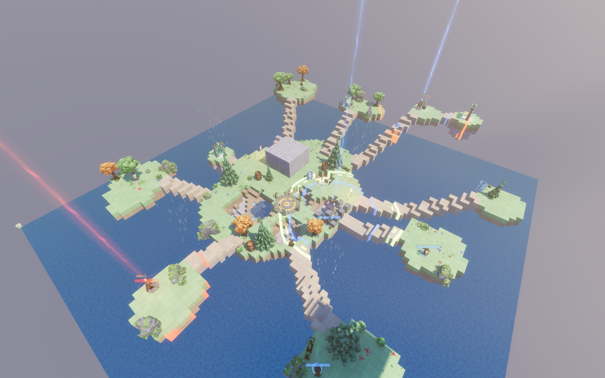
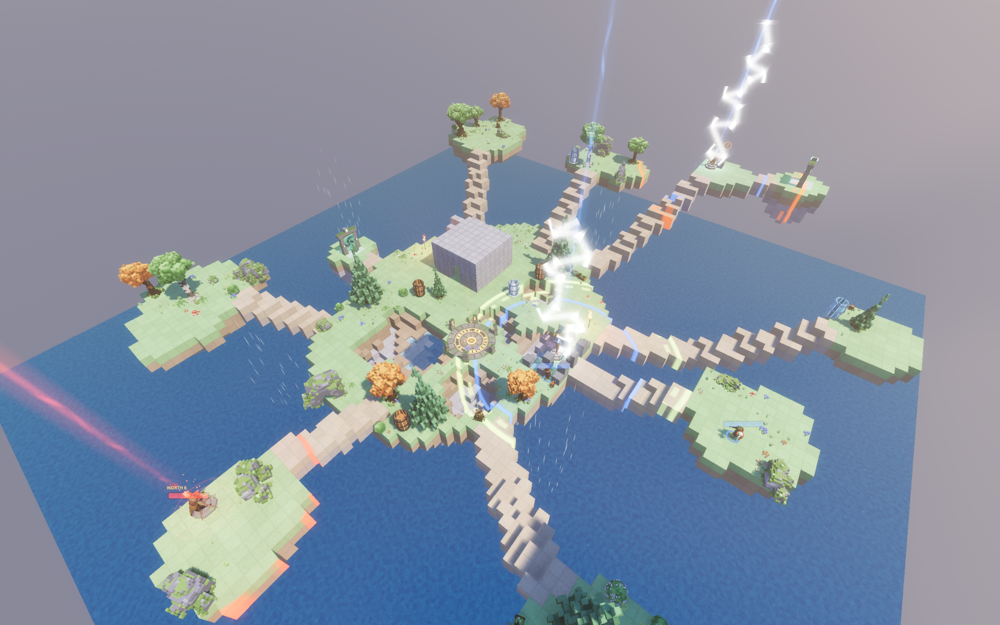
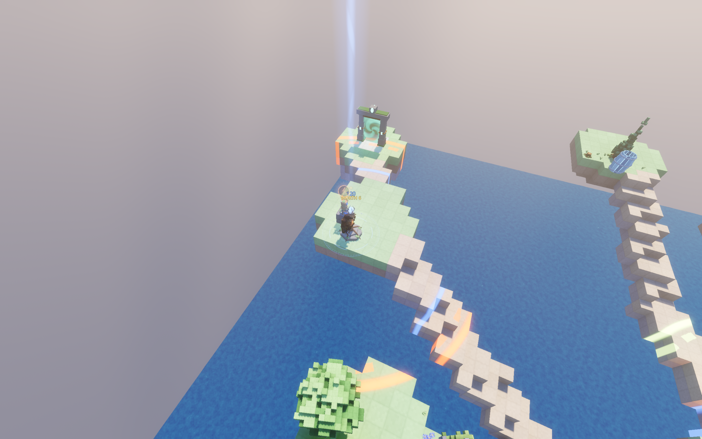

# Beacon Tactic — Support, Privacy & Marketing

Turn-based artillery on fully destructible voxel terrain. Eight animal knights, two sides, four each.

**This repository is not the game.** It is the public web presence for Beacon Tactic: the marketing page, the privacy policy, and the place to report problems. The game itself ships on Steam and the Mac App Store and is closed source.

---

## Pages

| | |
|---|---|
| **Marketing page** | <https://chanliu1983.github.io/beacon-tactic-site/> |
| **Privacy policy** | <https://chanliu1983.github.io/beacon-tactic-site/privacy.html> |

Both are single static files with an in-page English / 中文 toggle. No cookies, no trackers, no external requests.

---

## Reporting a problem

**Open an issue:** <https://github.com/chanliu1983/beacon-tactic-site/issues/new>

**You may submit issues in either English or Chinese / 您可以使用中文或者英文提交反馈**

There is no language switch on GitHub Issues, and there does not need to be one — write whichever language is easier. Every issue is read.

GitHub also lets you write an issue in the interface of your choice from the "…" menu, but plain English or plain Chinese text is perfectly fine and is usually faster.

### What to include

The more of this you give, the faster the answer:

1. **Where you got the build** — Steam, or the Mac App Store.
2. **Version** — bottom right of the main menu, shown as `v0.2.0 · mp10 · LAN build`.
3. **Platform** — macOS version, or Windows version.
4. **What you did**, and **what happened instead**.
5. **A screenshot or a short screen recording**, if it is a visual problem.

### Before you file it

A few things that look like bugs but are the rules working:

- **A beacon will not plant on an anchor footing.** The footing there is bedrock, so a mast on it could never be dug out. The game refuses the spot rather than hand you a tower only hit points can reach.
- **A guard has to be built from inside its mast's disc.** Its power cord is drawn from the mast, so a pad outside the circle does nothing.
- **No single shot clears a block from solid ground.** Blocks carry 80 hit points and the strongest weapon in the game does 65, so the first blast only cracks. The next shot into the same crater takes it. Two shots is the floor, on purpose.
- **A points lead draws lightning.** Every five rounds, if one side leads by more than five points, that side's masts are struck for 20 each. This is a comeback lever, not a bug.

---

## Screenshots

Raw, full-resolution captures live in [`/screenshots`](screenshots) — no text is baked into the pictures.

<!-- prettier-ignore -->
| | |
|---|---|
|  |  |
| Four against four on the islands. Every shot changes the ground it lands on. | A storm round. Every five rounds, the sky comes down on whoever is winning. |
|  | |
| A mast, and the disc of ground it scores for your side. | |

---

## The game in one paragraph

Beacon Tactic is a turn-based artillery game played on terrain that can be blown apart and built back up. Every ten rounds a knight may plant a territory beacon at their feet; its disc scores for that side for as long as it stands, and the first side to 100 points wins. Four crews, eight knights, four per side. Solo against AI or online with up to seven friends, over LAN or through a relay you run yourself. English and Chinese.

© 2026 Lei Liu. All rights reserved.

---

# 信标骑士 —— 支持、隐私与官网

在可以炸碎、也可以重新建起来的体素地形上打回合制炮击。八名动物骑士，两边各四名。

**这个仓库不是游戏本体。** 它是 Beacon Tactic 的公开网页门面：官网、隐私政策，以及提交问题的地方。游戏本体通过 Steam 和 Mac App Store 发行，源代码不公开。

---

## 页面

| | |
|---|---|
| **官网** | <https://chanliu1983.github.io/beacon-tactic-site/> |
| **隐私政策** | <https://chanliu1983.github.io/beacon-tactic-site/privacy.html> |

两个页面都是单文件静态网页，页内自带「English / 中文」切换开关。没有 Cookie，没有统计代码，不请求任何外部资源。

---

## 反馈问题

**提交 issue：** <https://github.com/chanliu1983/beacon-tactic-site/issues/new>

**您可以使用中文或者英文提交反馈。**

GitHub 的 issue 没有语言切换，但也不需要 —— 用哪种语言顺手就写哪种，每一条都会有人看。

### 请附上这些信息

信息越全，回复越快：

1. **从哪里获取的** —— Steam，还是 Mac App Store。
2. **版本号** —— 主菜单右下角，显示为 `v0.2.0 · mp10 · LAN build`。
3. **系统** —— macOS 版本，或 Windows 版本。
4. **你做了什么**，以及**实际发生了什么**。
5. 如果是画面问题，**附一张截图或一段短录屏**。

### 提交前先看一眼

下面这几条看着像 bug，其实是规则在正常工作：

- **信标不会种在锚基座上。** 那里的地基是基岩，种上去的信标永远挖不掉。游戏会直接拒绝这个位置，而不是给你一个只有血量能碰的塔。
- **守卫必须建在自己桅杆的作用圈里面。** 电线是从桅杆牵出来的，圈外的地基不起作用。
- **任何一发炮弹都无法从完好地面清掉一个方块。** 方块有 80 点耐久，全游戏最强的武器也只有 65，所以第一发只能打裂，同一个坑里的第二发才清得掉。两发是设计下限。
- **分数领先会招来雷击。** 每五回合，如果一方领先超过 5 分，那一方的信标会被每座扣 20 血。这是防止领先方龟缩的反扑机制，不是 bug。

---

## 截图

原始分辨率、无烘焙文字的截图放在 [`/screenshots`](screenshots) 目录里。

| | |
|---|---|
|  |  |
| 群岛上的四对四。每一发都会改变它落点处的地面。 | 风暴回合。每五回合，天空会砸向领先的一方。 |
|  | |
| 一座信标，以及它为你的阵营计分的那片地。 | |

---

## 一段话介绍

Beacon Tactic 是一款回合制炮击游戏，战场地形可以被炸碎，也可以重新建起来。每十回合，骑士可以在自己脚下种下一座领土信标；只要它还立着，它的领地就为这一方计分，先到 100 分的一方获胜。四个角色、八名骑士、每边四人。可以单人对着 AI 玩，也可以和最多七位朋友联机，走局域网或你自己搭的 relay。英文与中文。

© 2026 Lei Liu. 保留所有权利。

